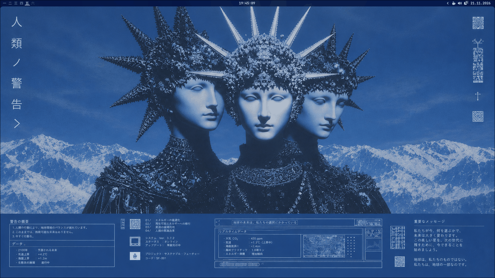
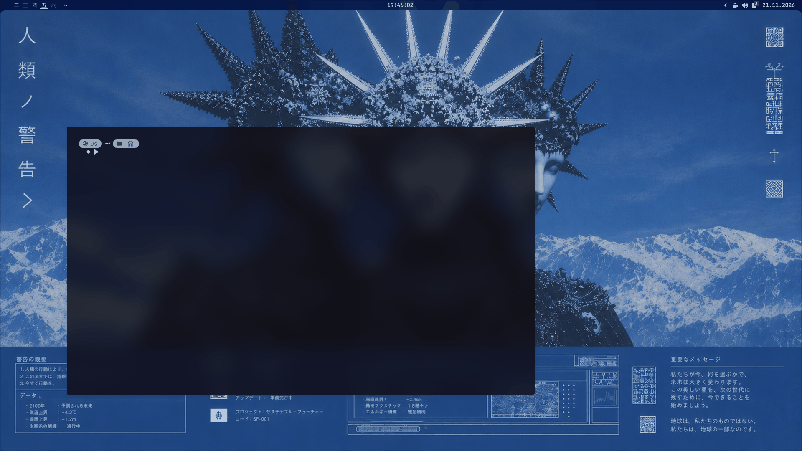
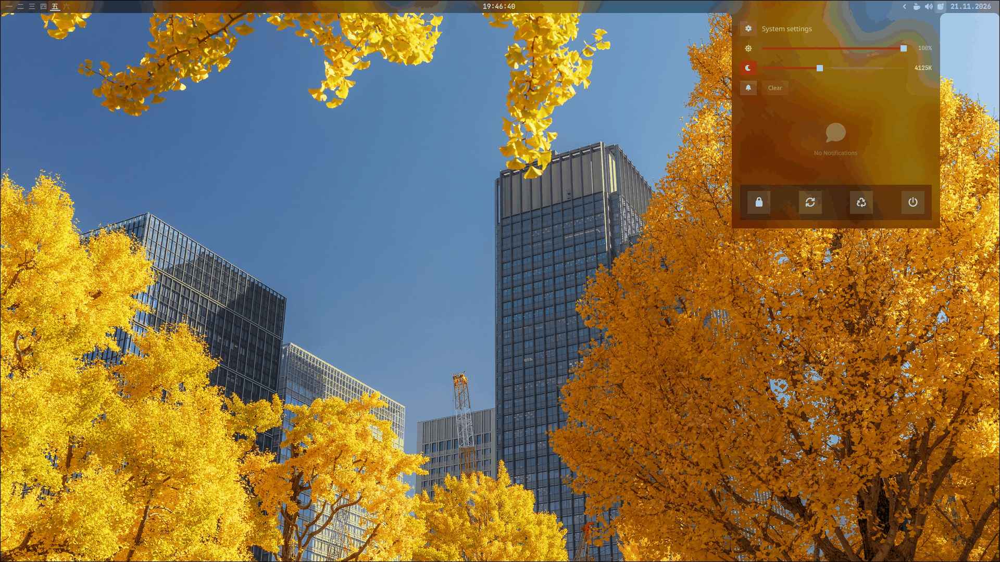
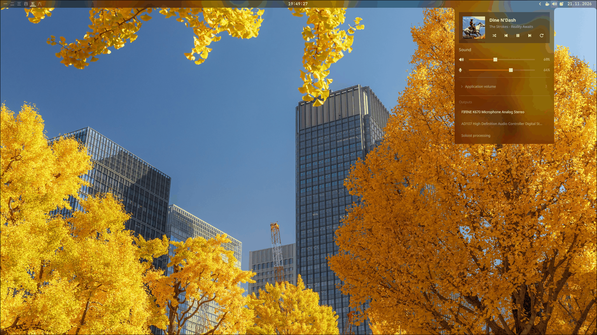
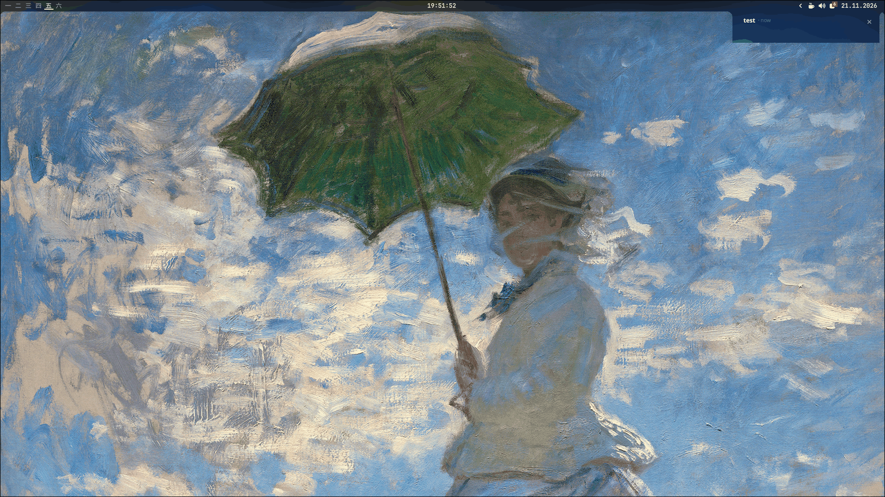
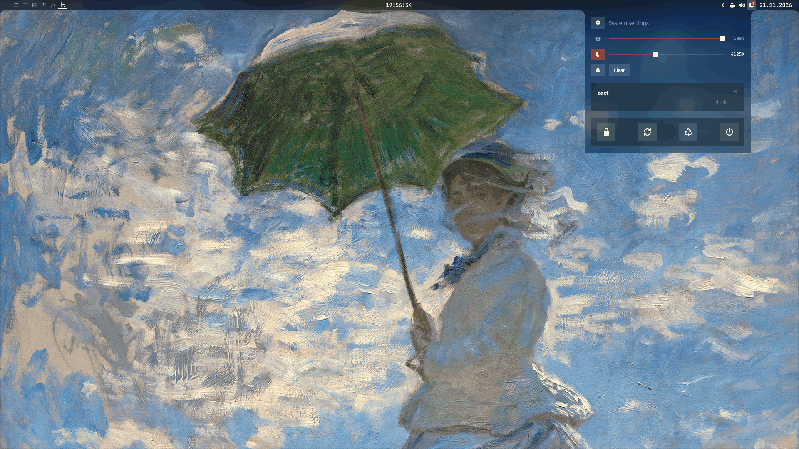
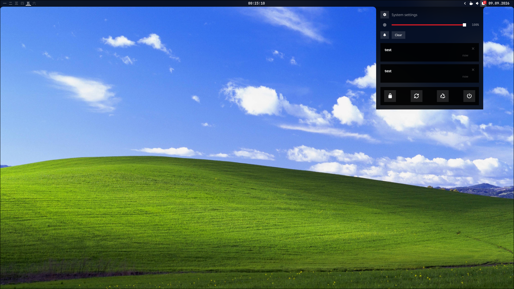

# My dots and stuff that i use

## Installation

### Requirements

- Arch Linux (uses `pacman` and `sudo`)
- `git`, to clone this repo
- `rsync`, used to sync configs *(installed automatically when running `full`)*

### Usage

Run interactively with a menu:

```sh
./install.sh
```

Or pass a command directly:

```sh
./install.sh [fonts|apps|config|full|greeter|--update]
```

| Command | What it does |
| --- | --- |
| `fonts` | Installs the font packages only |
| `apps` | Installs shell & app packages (optional Bluetooth), enables services, and applies post-install fixes |
| `config` | Syncs dotfiles into `~/.config` (backing up replaced files to `~/.config_backup_*`) and installs `quickgreet` |
| `full` | Full setup: fonts, programs, configs, login screen, services, and post-install fixes |
| `greeter` | Installs/updates only the `quickgreet` login screen (`/usr/share/quickgreet`) and enables `greetd` |
| `update` / `--update` | Updates dotfiles cleanly without creating backup folders, preserving local customizations (`theme.lua`, `monitors.lua`, `gaming.lua`, `autostart.lua`, `hypridle.conf`, `quicklock.json`, `quickgreet.json`) and refreshing `quickgreet` if installed |

> **Tip:** Run `./install.sh` as your normal user (not `root`) — it calls `sudo` only when needed.

OBS: Some of my configs are still messy or broken. I plan to clean and fix them later. I’m publishing this now because a few of my friends showed interest.

  
<details>
<summary>Screenshots</summary>

  
  
  
  
  
  
  

</details>

Credits to the people who helped me achieve my 'rice':

[end_4](https://github.com/end-4/dots-hyprland)

[BreadOnPenguins](https://github.com/BreadOnPenguins)

[Alexays](https://github.com/Alexays/Waybar)

[TheFrankyDoll](https://github.com/TheFrankyDoll/win10-style-waybar)

[ErikReider](https://github.com/ErikReider/SwayNotificationCenter)

[lvntcnylmz](https://github.com/ErikReider/SwayNotificationCenter/discussions/183#discussioncomment-5120181)

[saneAspect](https://www.youtube.com/@saneAspect)

[JaKooLit](https://github.com/JaKooLit/Hyprland-Dots)

[Samillion](https://github.com/Samillion/ModernZ)
